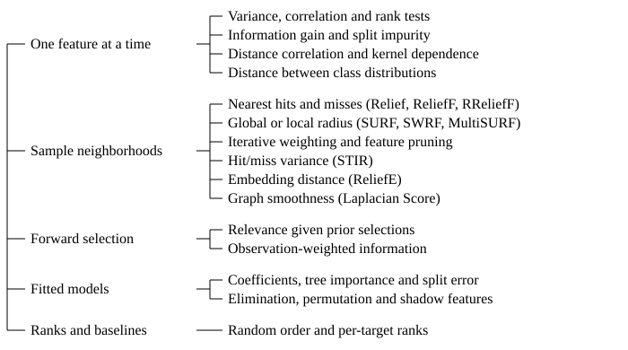

# ReliefE

`reliefe` ranks tabular features for classification, regression, multilabel and
multi-output prediction, unsupervised exploration, and right-censored survival
data. Its native ReliefE implementation uses Numba and optional manifold
embeddings. The sklearn-compatible `FeatureRanker` exposes the wider method
catalog and preserves original feature identities.

Use `from reliefe import FeatureRanker, list_methods` and inspect
`list_methods()` for method IDs, accepted targets, sparse input support, and
score semantics. The bounded `rank_features` function remains available for
small classification tables and MCP clients.

## Try the rankers

From the repository root, run:

```bash
uv run python examples/try_rankers.py
uv run python examples/try_rankers.py --task multilabel f relief cmim
uv run python examples/try_rankers.py --task multilabel --strategy label-powerset cmim
uv run python examples/try_rankers.py --task multiclass --list
```

Each row gives the method, the target strategy and the feature order. Choose `--all` to try every compatible method and see which optional backends need installation. The example also has datasets for regression, multi-output regression (`multioutput`), survival and unsupervised ranking. To evaluate predictive performance on held-out folds, see [the benchmark example](examples/minimal_benchmark.py).

For your own data:

```python
from reliefe import FeatureRanker, classification_strategies

strategies = classification_strategies("multilabel")
ranker = FeatureRanker("cmim", target_strategy="auto", top_k=5).fit(X_train, Y_train)
selected_test = ranker.transform(X_test)
```

Use a class vector for multiclass classification (MCC) or a binary indicator matrix for multilabel classification (MLC). With `target_strategy="auto"`, direct MCC and joint MLC algorithms keep their scoring rule. Binary-only MCC rankers fit one model per class against the rest. Single-output classification rankers fit each MLC label separately (binary relevance). Both reductions give each target equal weight, average tied feature ranks, and return a mean rank where lower is better. A constant label gives all features the same rank. Inspect `target_strategy_`, `per_target_ranks_` and `target_names_` on reduced fits. Binary relevance measures label-specific relevance independently. ReliefE's joint MLC score can use distances between whole label vectors. For a joint reduction, set `target_strategy="label-powerset"`. Each distinct training label vector becomes a class. Inspect `label_combinations_` to see those classes. Rare combinations must satisfy the base ranker’s sample requirements. [Tsoumakas and Katakis on multilabel transformations](https://doi.org/10.4018/jdwm.2007070101)

Fit the ranker inside the training fold when comparing methods.

## Feature ranking taxonomy

[](images/feature-ranking-tree.svg)

Read the tree from left to right. A **myopic** filter evaluates one input column at a time. A **neighborhood** method constructs distances across columns before assigning credit to each feature, so a feature can matter through an interaction. In the conditional-information branch, earlier selections change the score of the next candidate. A model-based rank depends on the learner, loss and data. The tree groups alternate implementations under one name. The table below lists every public ID.

### Complete method catalogue

<!-- algorithm-catalog -->
| Scoring family | Scoring rule | Public method IDs |
|---|---|---|
| Marginal filters | Dispersion | `variance`, `numba-variance` |
| Marginal filters | Association and group tests | `pearson`, `numba-pearson`, `spearman`, `numba-spearman`, `kendall`, `kruskal`, `f`, `numba-f`, `chi2`, `numba-chi2` |
| Marginal filters | Censored outcome ordering | `survival-concordance` |
| Marginal filters | Information and impurity | `mi`, `numba-info-gain`, `numba-gain-ratio`, `numba-symmetrical-uncertainty`, `numba-gini`, `core-infgain`, `core-gainratio`, `core-mdl`, `core-gini`, `core-dkm` |
| Marginal filters | Split accuracy and error | `core-accuracy`, `core-mseofmean`, `core-myopicrelieff` |
| Marginal filters | Costs and split weighting | `core-dkmcost`, `core-gainratiocost`, `core-mdlsmp`, `core-uniformdkm`, `core-uniformgini`, `core-uniforminf`, `core-uniformaccuracy`, `core-equaldkm`, `core-equalgini`, `core-equalinf` |
| Marginal filters | Class distribution distance | `core-impurityeuclid`, `core-impurityhellinger`, `core-equalhellinger`, `core-disthellinger`, `core-distauc`, `core-distangle`, `core-disteuclid` |
| Neighborhoods | k-NN hits and misses | `relief`, `relieff`, `rebate-relieff`, `core-relief`, `core-relieffequalk` |
| Neighborhoods | Historical categorical Relief | `relief-1994-a`, `relief-1994-b`, `relief-1994-c`, `relief-1994-d`, `relief-1994-e`, `relief-1994-f` |
| Neighborhoods | Neighbor and update weights | `core-relieffexprank`, `core-relieffdistance`, `core-relieffsqrdistance`, `core-relieffmerit`, `reliefmss`, `numba-reliefmss`, `mu-relief`, `numba-mu-relief` |
| Neighborhoods | Adaptive neighbor count | `reliefseq`, `core-relieffbestk`, `core-rrelieffbestk` |
| Neighborhoods | Continuous target updates | `rrelieff`, `core-rrelieffequalk`, `core-rrelieffexprank`, `core-rrelieffdistance`, `core-rrelieffsqrdistance`, `core-rrelieffwithmse` |
| Neighborhoods | Cost-sensitive neighbors | `core-relieffexpc`, `core-relieffavgc`, `core-relieffpe`, `core-relieffpa`, `core-relieffsmp`, `core-reliefkukar` |
| Neighborhoods | Global distance threshold | `surf`, `numba-surf`, `surf-star`, `numba-surf-star`, `swrf`, `numba-swrf`, `swrf-star`, `numba-swrf-star` |
| Neighborhoods | Per-observation threshold | `multisurf`, `numba-multisurf`, `multisurf-star`, `numba-multisurf-star`, `multiswrf`, `numba-multiswrf`, `multiswrf-star`, `numba-multiswrf-star`, `multiswrfdb`, `numba-multiswrfdb`, `multiswrfdb-star`, `numba-multiswrfdb-star` |
| Neighborhoods | Learned distance weights | `irelief`, `numba-irelief`, `iterative-relief`, `numba-iterative-relief`, `boostedsurf`, `iter` |
| Neighborhoods | Feature subsets and pruning | `turf`, `numba-turf`, `vls`, `numba-vls`, `ec-relieff` |
| Neighborhoods | Hit/miss variance | `stir-relieff`, `stir-surf`, `stir-multisurf` |
| Neighborhoods | Embedding neighborhoods | `reliefe` |
| Neighborhoods | Neighbor graph smoothness | `laplacian` |
| Conditional information | Greedy subset construction | `mrmr`, `jmi`, `cmim`, `cife` |
| Predictive models | Fitted model importance | `linear`, `forest`, `estimator` |
| Predictive models | Error after splitting | `core-mseofmodel`, `core-maeofmodel` |
| Predictive models | Recursive elimination | `rfe` |
| Predictive models | Perturbation and shadows | `permutation`, `shadow-forest`, `boruta` |
| Aggregation and controls | Rank across target columns | `per-target` |
| Aggregation and controls | Random ordering | `random` |
<!-- /algorithm-catalog -->

### Implementations and attribution

All `numba-` methods use scoring kernels maintained in this repository and compiled by Numba. Original Relief, ReliefF, ReliefE, RReliefF, ReliefSeq, the six 1994 methods, the four greedy information criteria and survival concordance also use native kernels. The estimator handles input validation, task dispatch and subset bookkeeping in Python. For a dense continuous table, `FeatureRanker("numba-multisurf")` runs with the base install. The radius methods accept explicit zero-based `categorical_features` in `method_params`. The native margin and subspace methods operate on range-scaled numeric features.

* STIR computes a native Numba pooled pseudo-t statistic for binary case-control data with fixed-k, global-radius or per-observation neighborhoods. It uses range-scaled Manhattan distance and the untransformed feature difference. A constant feature or an empty radius neighborhood can yield an undefined statistic. [STIR paper](https://doi.org/10.1093/bioinformatics/bty788) · [authors’ R implementation](https://github.com/insilico/stir)
* Original Relief and the categorical, regression, adaptive-neighborhood and embedding extensions follow the corresponding publications. [Kira and Rendell](https://cdn.aaai.org/AAAI/1992/AAAI92-020.pdf) · [Kononenko’s RELIEF-A through F](https://doi.org/10.1007/3-540-57868-4_57) · [ReliefF and RReliefF](https://doi.org/10.1023/A:1025667309714) · [ReliefSeq](https://pubmed.ncbi.nlm.nih.gov/24339943/) · [ReliefE](https://doi.org/10.1007/s10994-021-05998-5)
* ReBATE supplies the reference IDs for the SURF and SWRF families, μ-Relief, TuRF, VLS, Iter and rebate-relieff. Relief.jl supplies the published comparison implementations for reliefmss, boostedsurf, iterative-relief, irelief and ec-relieff. Native counterparts have their own IDs and defaults. [ReBATE source](https://github.com/UrbsLab/scikit-rebate) · [original method citations](https://epistasislab.github.io/scikit-rebate/citing/) · [Relief.jl source and bibliography](https://github.com/jernejvivod/Relief.jl)
* The core-prefixed methods use native Numba scoring kernels verified against the CORElearn authors’ evaluators. Boruta uses BorutaPy. Model-based estimators and permutation use scikit-learn. Kendall and Kruskal use SciPy. [CORElearn source archive](https://cran.r-project.org/src/contrib/Archive/CORElearn/) · [BorutaPy](https://github.com/scikit-learn-contrib/boruta_py) · [scikit-learn](https://scikit-learn.org/stable/modules/feature_selection.html) · [SciPy](https://docs.scipy.org/doc/scipy/reference/stats.html)
* Native information criteria use discretized training columns. Laplacian Score evaluates local smoothness on an unsupervised neighbor graph. [Brown et al. on information selection criteria](https://jmlr.org/papers/v13/brown12a.html) · [He, Cai and Niyogi on Laplacian Score](https://proceedings.neurips.cc/paper/2005/hash/b5b03f06271f8917685d14cea7c6c50a-Abstract.html)

## Install

```bash
uv sync
uv sync --group dev
```

This is a `uv`-first repository. Use the base sync for the library, and add the `dev` group when you want the test toolchain.

## Run

```bash
uv run python examples/minimal_reliefe2.py
uv run python examples/minimal_reliefe.py
uv run python examples/custom_embeddings.py
```

## Test

```bash
make test
```

## Layout

- `reliefe/`: core algorithm and utility code
- `examples/`: runnable smoke-sized examples
- `data/`: bundled datasets used by examples and tests
- `tests/`: standard-library smoke tests
- `docs/`: published documentation assets

## Notes

- `ReliefE.fit(..., embedding_method="auto")` prefers UMAP and falls back to SVD when UMAP is unavailable.
- The bundled examples are intentionally small enough to be used as smoke tests.

## Reference

Paper: Škrlj et al., "ReliefE: feature ranking in high-dimensional spaces via manifold embeddings", Machine Learning (2021).

Docs: https://skblaz.github.io/reliefe/

## Rank a small table

```python
from reliefe import rank_features

result = rank_features(
    x=[[0., 0., 1.], [0., 1., 1.], [1., 0., 0.], [1., 1., 0.]],
    y=["control", "control", "case", "case"],
    feature_names=["signal", "noise", "inverse_signal"],
    top_k=2,
)
print(result["ranking"])
# [{'index': 0, 'score': 1.0, 'name': 'signal'},
#  {'index': 2, 'score': 1.0, 'name': 'inverse_signal'}]
```

This convenience function and the MCP tool share the same implementation. They
use direct Relief distances with column range scaling, fixed sampling, and no
embedding randomness. Supply finite numeric features and integer or string class
labels. There must be at least two classes with at least two examples each;
`k` defaults to 1 and must be smaller than the smallest class size. `num_iter`
defaults to 128 and is capped at the number of rows. Ties retain column order.
Scores are signed relevance estimates, not probabilities or causal effects.
Fit feature selection on training folds only to avoid data leakage.

The tool accepts at most 512 rows, 1024 features, 131072 cells, and 512 iterations.
`top_k` limits the returned ranking; `scores` always contains every feature score
in original column order. The result also records dimensions, effective `k` and
iteration count, method, and normalization. Impute missing values and encode
categorical features first. For larger or sparse inputs, manifold embeddings,
or multi-label targets, use the existing `ReliefE` estimator directly.

## Use as an MCP tool

The optional MCP server requires Python 3.10+ and uses the official MCP Python
SDK's v1 line (`mcp<2`). The base library retains Python 3.8+ support and does not
require the SDK. From a checkout:

```bash
uv sync --extra mcp
uv run --extra mcp reliefe-mcp
# Alternatively: uv run --extra mcp python -m reliefe.mcp_server
```

For pip installations, use `pip install '.[mcp]'` from the checkout, then run
`reliefe-mcp`. The extra will also be available as `reliefe[mcp]` when this change
is released. The server uses stdio, so launch it from an MCP client; it waits for
protocol messages when started in a terminal.

Add this to your MCP client's server configuration, replacing the path with the
absolute checkout location (it works independently of the client's directory):

```json
{
  "mcpServers": {
    "reliefe": {
      "command": "uv",
      "args": ["run", "--directory", "/absolute/path/to/reliefe",
               "--extra", "mcp", "reliefe-mcp"]
    }
  }
}
```

The server exposes one tool, `rank_features`, with the arguments and result
shown above. Its schemas describe input bounds and structured results. Invalid
calls return MCP tool errors; the server remains available for the next call.
It computes locally on the supplied table without reading files, writing files,
or opening a network listener. Library logs use stderr; stdout is reserved for
MCP messages. The first compiled call can take longer while Numba initializes.

`make test` now checks 100% statement coverage, a real stdio MCP exchange, and
separate numerical tests with Numba JIT enabled. On Python 3.8/3.9 the optional
server tests are skipped; use Python 3.10+ for the full coverage gate.

### Changes to native ReliefE rankings

Embedded fits use the embedding to find neighbors and attribute their feature
differences to original input columns. Earlier versions could put a latent
coordinate's score under an unrelated input column. Multilabel checkpoints now
retain accumulated weights across skipped updates, and subset distance is zero
for equal label sets and one otherwise. The sparsifier operates on the sampled
rectangular CSR matrix. Use `random_state` to control sampling and built-in
embeddings. Inspect `effective_embedding_`, `k_` and `num_iter_` after fitting.

## Rank and select features in Python

`FeatureRanker` fits on a numeric table, returns a full ranking in input-feature
coordinates, and selects columns in their original order. It works as a step
in a scikit-learn pipeline. Use an explicit regression task for integer-valued
responses. Fit the entire pipeline inside each training fold.

```python
from sklearn.datasets import load_breast_cancer
from sklearn.linear_model import LogisticRegression
from sklearn.model_selection import cross_val_score
from sklearn.pipeline import make_pipeline
from sklearn.preprocessing import StandardScaler
from reliefe import FeatureRanker, list_methods

X, y = load_breast_cancer(return_X_y=True)
pipeline = make_pipeline(FeatureRanker("relieff", top_k=5), StandardScaler(),
                         LogisticRegression(max_iter=1000))
fold_scores = cross_val_score(pipeline, X, y, cv=3)
pipeline.fit(X, y)
print(pipeline[0].ranking()[:5])
print(list_methods()["rrelieff"])
```

| Method | Targets | Inputs | Meaning |
| --- | --- | --- | --- |
| `relief` | Binary | Dense | Original range-normalized, squared-difference update using every query |
| `relieff`, `reliefe` | Classification, plus multilabel for ReliefE | Dense, sparse | Signed feature weights, with direct or embedding-based neighborhoods |
| `rrelieff` | Regression | Dense | Rank-weighted conditional difference in feature changes |
| `variance`, `random` | Unsupervised | Dense, sparse | Population variance or seeded random baseline |
| `f`, `mi` | Classification, regression | Dense, sparse | F statistic or mutual information. For sparse MI sklearn expects discrete predictors |
| `chi2` | Classification | Nonnegative dense or sparse | Chi-square statistic |
| `mrmr` | Classification | Dense | Greedy relevance-minus-redundancy selection order with quantile discretization |
| `linear`, `forest` | Classification, regression | Dense, sparse | Absolute standardized coefficients averaged across classes, or impurity decrease |
| `rfe` | Classification, regression | Dense, sparse | Elimination rank from a cloned estimator |
| `permutation` | Classification, regression | Dense | Score decrease on an internal validation split. Inspect `validation_indices_`, `estimator_`, `scoring_` and `permutation_std_` |
| ReBATE methods below | Classification, regression | Dense | Upstream feature weights, including wrapper elimination tiers for TuRF |

Install the optional **ReBATE** integration on Python 3.9+ with
`pip install 'reliefe[rebate]'` (from a checkout, `uv sync --extra rebate`).
The catalog includes `rebate-relieff`, `surf`, `surf-star`, `multisurf`,
`multisurf-star`, `swrf`, `swrf-star`, `multiswrf`, `multiswrf-star`,
`multiswrfdb`, `multiswrfdb-star`, `mu-relief`, `turf`, `vls`, and `iter`.
Set backend options with `method_params`. For wrappers, `base_method` selects
a ReBATE core method and `base_params` configures it. The Python ranking
interface accepts finite encoded numeric features. ReBATE distance methods
can require quadratic memory in sample count. See the
[upstream implementations](https://github.com/UrbsLab/scikit-rebate).

`scores_` preserves native units in original column order. Ordinal methods
expose `scores_=None`. `ranks_` starts at one and permits ties. Equal values
retain column order at the top-k boundary. Undefined univariate statistics sort
last. Labeled tables retain their original names. Run
`uv run python examples/minimal_benchmark.py` for fold-local comparisons.

### CORElearn methods

All 37 classification and nine regression IDs originally exposed through CORElearn use Python and Numba. Kernels use the reference split, class-weight, neighborhood and score conventions. Numeric split criteria search ordered thresholds. Supply zero-based `categorical_features` for categorical columns and a `cost_matrix` in sorted class order for cost-sensitive methods.

```python
ranker = FeatureRanker("core-relieffexprank", method_params={"kNearestExpRank": 5})
```

The parity tests use frozen per-feature outputs from CORElearn 1.56.0 and Relief.jl 0.2.0. They cover all 51 migrated IDs, compare original column order before selection, and run with Numba enabled in CI. The fixtures include nonuniform costs, categorical splits, seeded sampling and regression-model options. [Parity tests](tests/test_reference_parity.py)

The Python entry point accepts explicit scoring options. See the [option signature](reliefe/corelearn.py) and [original CORElearn source](https://cran.r-project.org/src/contrib/Archive/CORElearn/).

### Comparing rankings and repeated measurements

* `reliefseq` takes the largest direct ReliefF score for each feature across
  `k_min ... k_max`. Inspect `best_k_` to see the winning neighborhood size.
* `laplacian` ranks unsupervised numeric features by their normalized graph
  energy on a symmetric heat-weighted k-neighbor graph. Lower scores rank first.
* `per-target` fits a base ranker to each response and averages tied ranks.
  Use `base_method` and `base_task` to configure multilabel or multi-output
  regression baselines. Constant targets contribute a neutral tied rank.
* `shadow-forest` estimates how often a variable beats the best independently
  shuffled shadow variable over repeated forest fits. Its scores are empirical
  frequencies. They carry no multiple-testing or false-discovery guarantee.

`compare_rankings(X, y, rankers, estimator, splits, scoring=...)` fits each
configuration separately on each training fold. It reports paired fold scores,
per-feature selection frequencies, and mean pairwise Jaccard overlap. Supply a
mapping from labels to rankers (use None for all columns) and precomputed splits
for group or time-series evaluation. Choose hyperparameters inside training folds.

Use `grouped_permutation_importance(fitted_estimator, X_test, y_test, groups)`
to shuffle correlated or one-hot columns together on held-out data. The returned
mapping contains one score decrease per repeat for each named group.

### The 1994 RELIEF series

`relief-1994-a` through `relief-1994-f` implement the six historical variants
on **discrete, numeric-coded attributes**. Use `method_params={"k": 3}` to
average over neighbors. A averages multiple hits and misses. B assigns uniform
mismatch probability to missing values. C uses B's search distance and omits
unobserved pairs from each attribute's hit/miss averages. D uses empirical
class-conditional mismatch probabilities. E extends D with pooled multiclass
misses. F draws misses per class and weights them by the unconditional class
priors in the 1994 equation. B–F accept NaN. Entirely missing columns score
zero; a class with no observed values uses the pooled training distribution.
The separate `reliefe` method implements the 2021 embedding algorithm.
[Kononenko, 1994](https://doi.org/10.1007/3-540-57868-4_57)

### Complementary Relief.jl methods

`reliefmss`, `boostedsurf`, `iterative-relief`, `irelief`, and `ec-relieff`
run in-process Numba kernels following the Relief.jl 0.2.0 scoring conventions. Iterative Relief and I-Relief use different updates. Evaporative Cooling returns elimination ranks. These methods accept dense numeric classification tables and support `method_params={"f_type": "discrete"}`. [Original implementations](https://github.com/jernejvivod/Relief.jl)

In Relief.jl 0.2.0, BoostedSURF can read its distance buffer before the first refresh. Repeating a fit with the same seed can then give different weights. The Numba implementation computes distances before scoring any query. Reference fixtures for BoostedSURF use initialized distances.

### Survival and temporal evaluation

`survival-concordance` accepts dense features and a two-column target containing
an observed-event flag and nonnegative follow-up time. It ranks by the absolute
value of twice Harrell's concordance minus one. `concordance_` preserves direction.
Tied feature values receive half credit. Pairs with an earlier censoring time
are excluded. Computation is quadratic in the number of rows. The runnable
`examples/specialist_ranking.py` also demonstrates forward-chaining regression
with lagged features and training-only selection.

Native embeddings now preserve large negative entries during sparsification,
sample at most the requested row budget, and accept COO matrices during
subsampling. The hyperbolic label metric reconstructs the time coordinate
before applying the hyperboloid distance.

### Additional statistical and all-relevant methods

Use `pearson`, `spearman`, or `kendall` for absolute regression association and
`kruskal` for a rank-based multiclass comparison. The discrete greedy selectors
`jmi`, `cmim`, `cife`, and `mrmr` expose an ordinal selection sequence.
Columns with at most the requested number of distinct values retain every level. Higher-cardinality columns use training-only quantile discretization (`method_params={"bins": 8}`).
[Information-theoretic criteria](https://jmlr.org/papers/v13/brown12a.html)

Install `reliefe[all-relevant]` to use `FeatureRanker("boruta")`. Inspect
`confirmed_` and `tentative_` for the backend's statistical decisions.
`top_k` controls the usual pipeline transformation independently. The optional
`estimator` argument accepts a cloneable tree estimator with feature
importances. [BorutaPy](https://github.com/scikit-learn-contrib/boruta_py)

To integrate another sklearn-compatible estimator, use
`FeatureRanker("estimator", estimator=model)`. The ranker clones and fits
the model on training rows. It reads native importances, or averages absolute
coefficients across outputs. Supply `method_params={"importance_getter": fn}`
when the fitted model uses a different representation. The callable returns
one value per original feature, with larger values ranked first.

For ARFF datasets, `load_arff(..., source_index_ranges=True)` maps each
original ARFF attribute index to its half-open range of encoded columns.
`feature_ranking_wrapper` uses that mapping to aggregate scores for reordered
or nonconsecutive attributes. Native `ReliefE.fit(..., task_type="multilabel")`
preserves multilabel semantics even in a fold where each row happens to have
exactly one positive label.

### Reproducible benchmark

Run `uv run python benchmarks/ranking_study.py` on Linux for seven seeded
workloads. Each case starts a fresh Python process. Timings separate the first
fit (including kernel compilation) from two subsequent fits. Peak RSS includes
the interpreter, numerical libraries and downstream evaluation. Workloads use
one thread per numerical backend. The real-data comparisons use 144 sampled
rows and four selected columns over three folds. On that run, direct ReliefF
obtained balanced accuracy 1.000 on XOR and 0.519 on Madelon. On multilabel
Medical the four-column ReliefE model obtained micro-F1 0.087 and the all-column
model obtained 0.459. The raw data include all baselines, folds, stability,
hardware and package versions. These timings were collected on a shared machine.
[Benchmark results](benchmarks/ranking_study_results.json)
